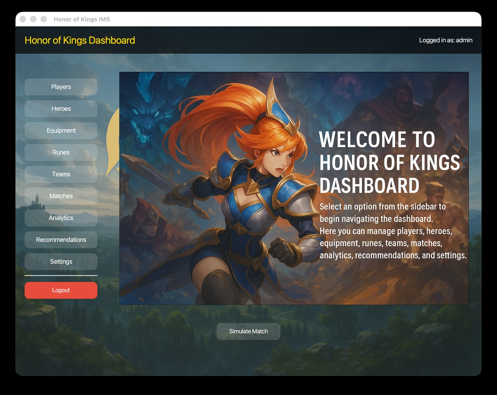
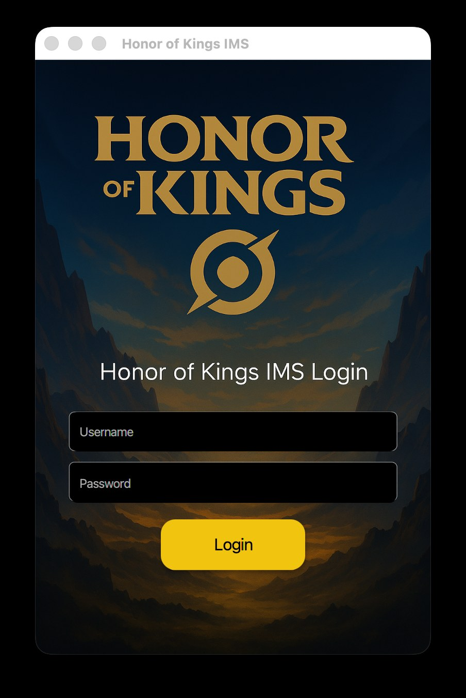

<div align="center">

# HoK Information Management System

**A JavaFX desktop workspace for Honor of Kings data, analytics, and match experiments.**

Manage players, heroes, equipment, runes, teams, and matches; explore recommendations and analytics; and run turn-based combat simulations through a local Java desktop application.

[](https://openjdk.org/)
[](https://openjfx.io/)
[](https://maven.apache.org/)
[](#architecture)
[](#verification)

[Overview](#overview) · [Features](#features) · [Screenshots](#screenshots) · [Architecture](#architecture) · [Build and Run](#build-and-run) · [Verification](#verification)

</div>

---

<a id="overview"></a>
## 1. Overview

HoK IMS is an educational desktop application for organising *Honor of Kings* game data and experimenting with team composition, recommendations, and match outcomes. It separates FXML views and controllers from domain models, services, repositories, and JSON persistence.

The application is offline and self-contained. Sample JSON data is included so the interface and business logic can be explored without an external database or game API.

> This is a coursework project for educational use. It is not affiliated with or endorsed by Tencent, and it does not provide live game data or production-grade security.

## 2. Features

| Module | Implementation |
|---|---|
| **Login and dashboard** | JavaFX login flow, role-aware application context, and navigation across management screens |
| **Players and heroes** | Player statistics, hero details, levels, win rates, and associated records |
| **Equipment and runes** | Stat bonuses, usage data, rune information, and management views |
| **Teams** | Team membership, aggregate level and win-rate information, and hero selection |
| **Matches** | Match records and turn-based combat experiments |
| **Analytics** | Leaderboards and data-driven views built from the included records |
| **Recommendations** | Logic-based hero, equipment, and team recommendations |
| **Combat engine** | Turn-based units, status effects, combat reports, and match simulation |
| **Settings and persistence** | Local JSON import/export and application settings |

<a id="screenshots"></a>
## 3. Screenshots

### Dashboard



### Login

<div align="center">

</div>

Both screens were captured from the current Maven-built application. The dashboard screenshot followed a real login using the included demo account.

<a id="architecture"></a>
## 4. Architecture

```text
FXML views
  ⇄ JavaFX controllers and SceneManager
  ⇄ Services
      ├── AnalyticsService
      ├── RecommendationServiceImpl
      ├── MatchSimulator and TurnBasedEngine
      └── Player, Hero, and Team services
  ⇄ Repositories and DataStore
  ⇄ Jackson + JavaTimeModule
  ⇄ Local JSON data
```

**Stack:** Java 21, JavaFX 17, Maven, Jackson Databind, Jackson JSR-310, and Lombok. JUnit Jupiter is declared for future tests, but the repository currently contains no test sources.

## 5. Build and Run

### Requirements

- JDK 21 or newer
- Maven 3.9+

```bash
git clone https://github.com/Cjj040721/HoK-Information-Management-System.git
cd HoK-Information-Management-System
mvn clean package
mvn javafx:run
```

All Java dependencies, including `jackson-datatype-jsr310`, are resolved through Maven. No manual JAR installation or IDE-specific library setup is required. The custom `src/resources` directory is included in the Maven resource configuration so FXML, CSS, and images are packaged correctly.

### Demo accounts

| Username | Password | Role |
|---|---|---|
| `admin` | `admin123` | Admin |
| `player` | `player123` | Player |

These are public demo credentials for the included local data, not production accounts.

<a id="verification"></a>
## 6. Verification

| Check | Result |
|---|---|
| Clean Maven package | **Passed**; 45 Java source files compiled |
| JavaFX launch | Passed through `mvn javafx:run` |
| Login workflow | `admin` / `admin123` accepted and the Dashboard opened |
| Screenshot provenance | Login and Dashboard captured from that running application |
| Automated tests | **No test sources present**; `mvn test` reports “No tests to run” |

The current JDK also reports JavaFX dependency-model warnings, Lombok `sun.misc.Unsafe` deprecation warnings, and unchecked-operation notes in `AnalyticsController`. These are documented rather than described as a zero-warning build.

Earlier documentation's SQLite, TestFX, JaCoCo, and numerical coverage claims did not match the repository and have been removed.

## 7. Repository Structure

```text
HoK-Information-Management-System/
├── src/
│   ├── main/java/com/example/hokims/
│   │   ├── combat/              # Turn-based engine, units, reports, and status effects
│   │   ├── core/                # User context
│   │   ├── dto/                 # Recommendation data transfer objects
│   │   ├── model/               # Player, Hero, Equipment, Rune, Team, Match, and User
│   │   ├── repository/          # DataStore and repositories
│   │   ├── service/             # Analytics, recommendation, match, and domain services
│   │   ├── ui/                  # JavaFX controllers and SceneManager
│   │   └── util/                # Authentication and JSON data management
│   └── resources/
│       ├── fxml/                # Login, dashboard, management, and analytics views
│       ├── css/                 # Interface styling
│       └── images/              # Application artwork
├── data/                        # Included JSON records and demo accounts
├── docs/assets/                 # Real login and Dashboard screenshots
├── pom.xml
└── LICENSE
```

## 8. Licence and Acknowledgements

Original project code is available under the [MIT Licence](LICENSE).

Created as **Beijing Jiaotong University Java coursework (2025)**. *Honor of Kings* names, images, and game-related data are used for educational purposes only and remain the property of their respective owners.

---

<div align="center">

**HoK IMS — Manage the data. Explore the composition. Simulate the match.**

Java 21 + JavaFX + Maven + Jackson + JSON

</div>
