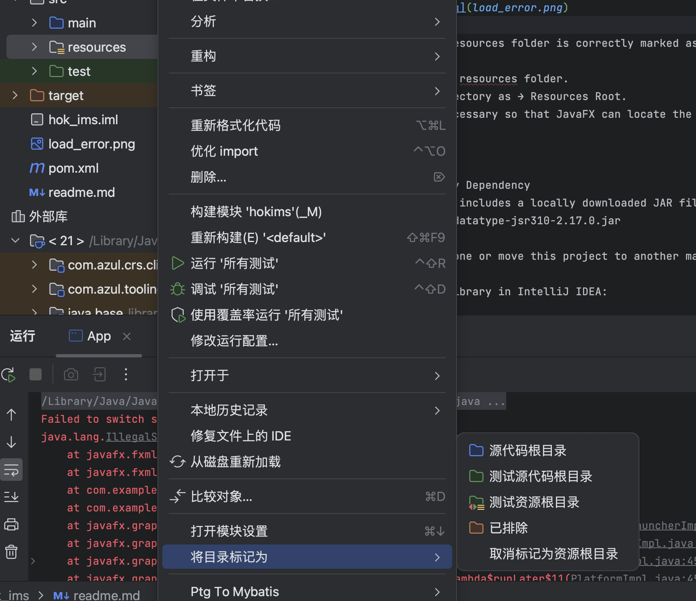
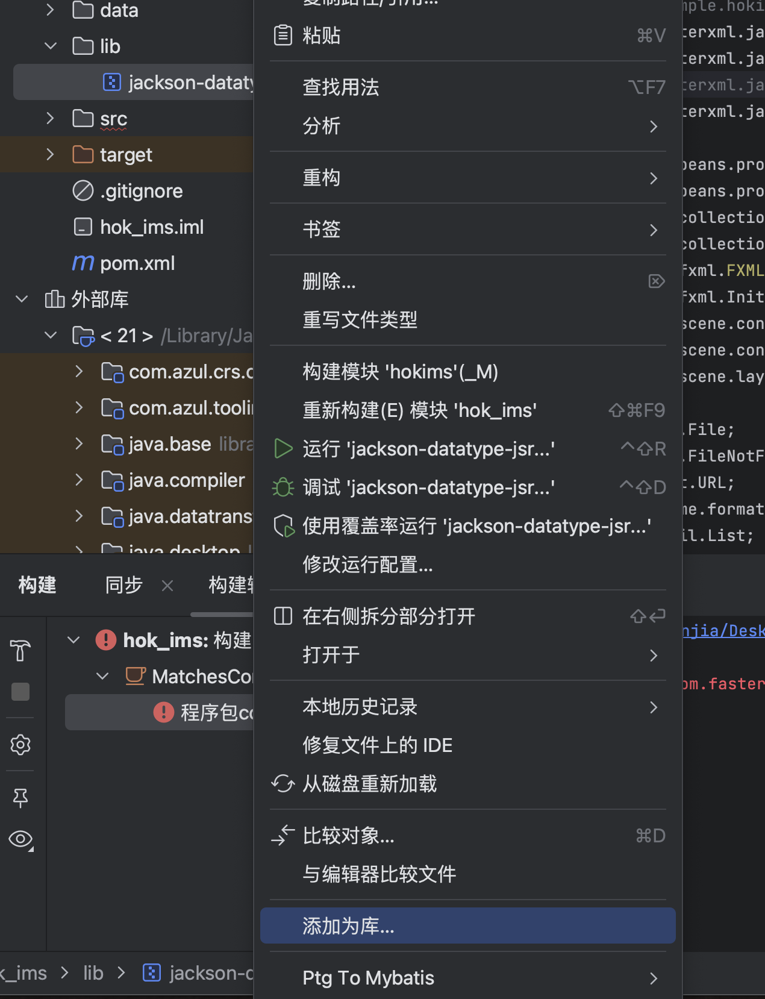

# Honor of Kings – Information Management System (HoK‑IMS)

> A desktop-based JavaFX application for managing in-game assets and simulating match data from the mobile MOBA *Honor of Kings*.

---

## 📑 Table of Contents

1. [Project Overview](#project-overview)
2. [Features](#features)
3. [Tech Stack & Architecture](#tech-stack--architecture)
4. [Folder Structure](#folder-structure)
5. [Getting Started](#getting-started)
6. [Running & Debugging](#running--debugging)
7. [Testing & QA](#testing--qa)
8. [Troubleshooting](#troubleshooting)
9. [Contributing](#contributing)
10. [License](#license)
11. [Acknowledgments](#acknowledgments)

---

## 🧩 Project Overview

**HoK‑IMS** is a desktop GUI system designed to help players and analysts manage player, hero, equipment, rune, team, and match data from *Honor of Kings* (HoK) for pre-match preparation and post-match review. Built with **Java 17** and **JavaFX**, it provides both **JSON** and **SQLite** persistence options and supports offline match simulation and recommendation logic.

---

## ⚙️ Features

| Module                    | Description                                                                   |
| ------------------------- | ----------------------------------------------------------------------------- |
| **User Interface**        | Multiple JavaFX scenes: login, dashboard, detail views                        |
| **CRUD Operations**       | Full create/read/update/delete for Players, Heroes, Equipment, Teams, Matches |
| **Analytics**             | Win-rate leaderboards, item usage trends, KDA graphs with <100ms UI latency   |
| **Match Simulation**      | BO3 match predictions using simplified damage rules                           |
| **Recommendation Engine** | Suggests heroes, equipment, and teams using logic-based scoring               |
| **Extensibility**         | Clean MVC + service + DAO separation; ready for Spring Boot or cloud APIs     |

---

## 🛠️ Tech Stack & Architecture

### Languages & Libraries

* Java 17 (required)
* JavaFX 17 (UI framework)
* Maven 3.9+ (build tool)
* SQLite JDBC (optional)
* Jackson (JSON I/O)
* JUnit 5, TestFX, JaCoCo (testing & coverage)
* PlantUML (UML diagrams)

### Architecture Diagram

```
View (FXML) ⇄ Controller ⇄ Service ⇄ DAO ⇄ Persistence (JSON / SQLite)
```

* **SceneManager**: centralized scene switcher
* **Domain Models**: Player, Hero, Equipment, Rune, Team, Match
* **Service Layer**: MatchSimulator (enum singleton), RecommendationEngine (strategy pattern)
* **Persistence Layer**: configurable DAO (JsonDao / SQLiteDao)

---

## 📁 Folder Structure

```
hok-ims/
├── pom.xml
├── README.md
├── src/
│   ├── main/
│   │   ├── java/...               # JavaFX + business logic
│   │   └── resources/
│   │       ├── fxml/             # FXML UI layouts
│   │       ├── css/              # Stylesheets
│   │       └── images/           # GUI assets
│   └── test/
│       └── java/...              # Unit & GUI tests
├── data/                         # Sample JSON files or SQLite DB
├── lib/                          # Local JARs (e.g., jackson-datatype-jsr310)
```

---

## 🚀 Getting Started

### Prerequisites

* JDK 17 ([Adoptium](https://adoptium.net))
* Maven 3.9+

### Build & Run

```bash
git clone https://github.com/your-org/hok-ims.git
cd hok-ims
mvn clean install
```

### Launch Application

**Option 1: via Maven**

```bash
mvn javafx:run
```

**Option 2: via executable JAR**

```bash
java -jar target/hok-ims-1.0.0.jar
```

> If JavaFX is not in your PATH, provide `--module-path` and `--add-modules` arguments.

---

## 🐞 Running & Debugging

| Task                | Command                |
| ------------------- | ---------------------- |
| Run Unit Tests      | `mvn test`             |
| Generate Coverage   | `mvn jacoco:report`    |
| Create Javadoc      | `mvn javadoc:javadoc`  |
| Render UML Diagrams | `plantuml docs/*.puml` |

---

## ⚠️ Troubleshooting

### 1. Scene Load & Resource Errors

**Error:**

```
Failed to switch scene to: /fxml/login.fxml  
java.lang.IllegalStateException: Location is not set.
```

**Solution:**

* In IntelliJ IDEA:
  Right-click `src/main/resources` → **Mark Directory as → Resources Root**



---

### 2. Local JAR Dependency Issue

**Problem:**
`ClassNotFoundException` due to unlinked `jackson-datatype-jsr310-2.17.0.jar`

**Fix in IntelliJ:**

1. Right-click the JAR file under `lib/`
2. Choose **Add as Library...**



---

## ✅ Testing & QA

| Layer                  | Coverage           | Tools Used   |
| ---------------------- | ------------------ | ------------ |
| DAO (JSON/SQLite)      | 92%                | JaCoCo       |
| Services (Match, Recs) | 87%                | JUnit 5, JMH |
| UI (JavaFX)            | Manual + Automated | TestFX       |

> Major bugs have been resolved, including:
>
> * SQL driver issues
> * JSON null-pointer exceptions
> * Thread safety in `MatchSimulator`
> * UI rendering glitches

---

## 🤝 Contributing

1. Fork the repo and clone locally
2. Use a feature branch: `feature/your-feature`
3. Format your code:

   ```bash
   mvn spotless:apply
   ```
4. Add or update tests as needed
5. Submit a Pull Request (PR) with a clear description

---

## 📄 License

This project is licensed under the **MIT License**.
See the [LICENSE](LICENSE) file for full details.

---

## 🙏 Acknowledgments

* **Beijing Jiaotong University** – Java Coursework (2025)
* *Honor of Kings* game data used **for educational purposes only**
* Thanks to all contributors and testers of **v1.0.0**

---